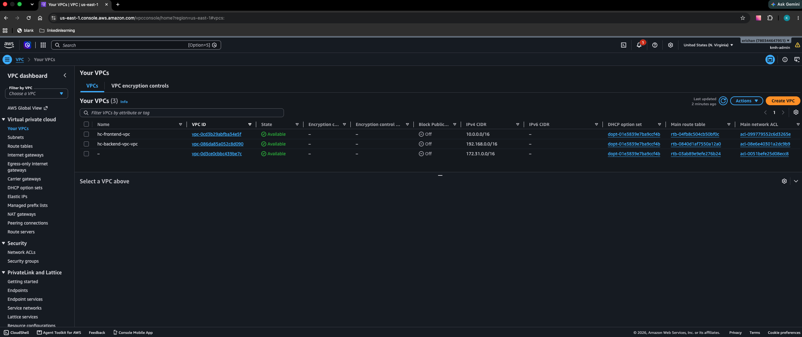
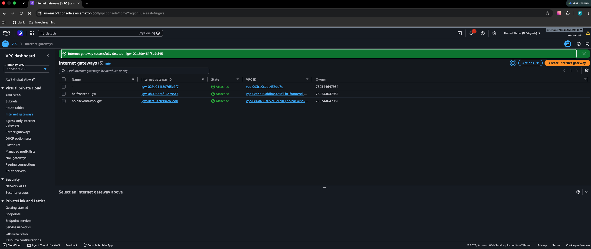
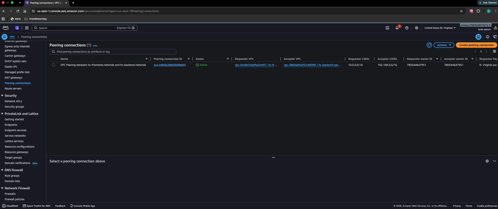
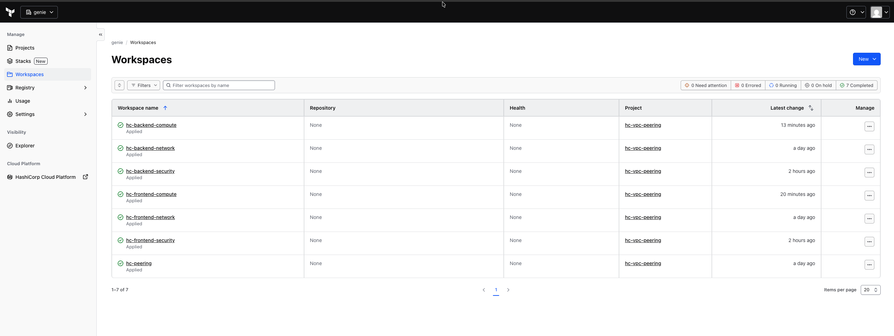
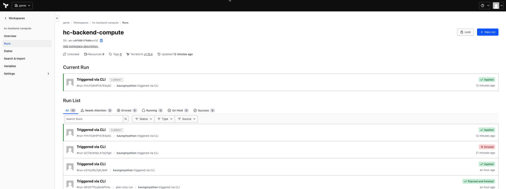
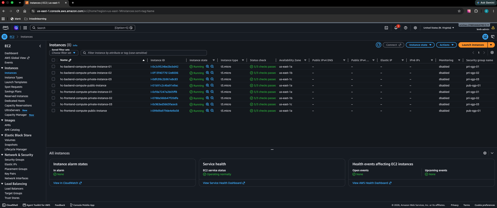
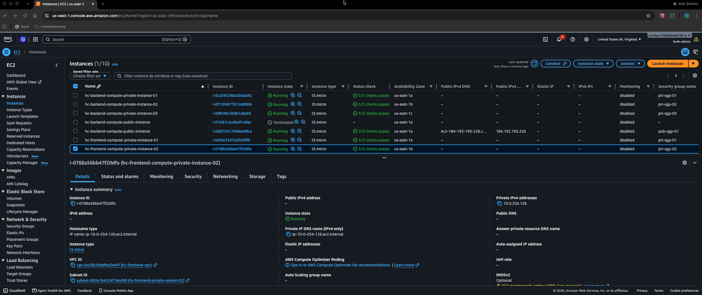
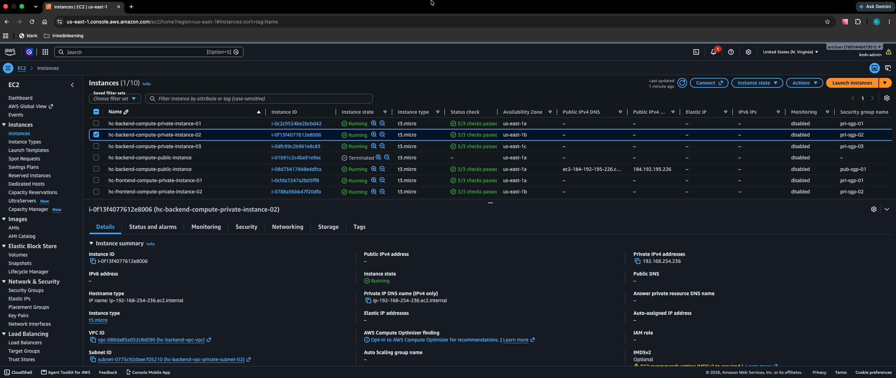

# Intra-Region VPC Peering — HCP Terraform Remote Execution Hands-On


Two mirrored AWS VPCs (`hc-frontend-vpc` `10.0.0.0/16`, `hc-backend-vpc` `192.168.0.0/16`, both `us-east-1`)
built, peered, and firewalled entirely by Terraform — **VCS-driven**: a merge to `main` plans and
applies the affected stacks in HCP Terraform (org `genie`), authenticating to AWS with OIDC dynamic
credentials. The seven workspaces are created once in the HCP UI; cross-stack wiring is done via
remote state reads.

> Region `us-east-1` · Terraform `>= 1.12` · `hashicorp/aws ~> 6.0` (regional NAT) · 7 HCP workspaces
> · 116 AWS resources · AWS account `780344647951`

> Diagram caveats: the right-hand VPC is `hc-backend-vpc` (label typo), and the region badge is
> illustrative — everything is built in `us-east-1`.

---

## Architecture

### Workspace graph (deployment order, strictly linear)

```
hc-frontend-network ──────┬──────── hc-backend-network
         │                 │                 │
         ▼                 │                 ▼
hc-frontend-security       │        hc-backend-security
         │       \         │         /       │
         │        \        ▼        /        │
         │         └─→ hc-peering ←─┘        │
         │        reads both networks (routes)
         │        + both securities (portals)
         ▼                                   ▼
hc-frontend-compute                 hc-backend-compute
        each compute stack reads: own network stack + own security stack
```

| Workspace | ID | Directory | Auto-apply | Resources | Owns |
|---|---|---|---|---|---|
| `hc-frontend-network` | `ws-PFodMsoD8GG6gJc5` | `frontend-network/` | yes | 19 | VPC + 3 public + 3 private subnets, IGW, regional NAT, per-AZ private route tables |
| `hc-backend-network` | `ws-au4bxAZoN1eF1SMb` | `backend-network/` | yes | 19 | mirror of the above |
| `hc-frontend-security` | `ws-rmfNvLuvNRNM82RU` | `frontend-security/` | yes | 17 | SG chain (pub-bastion → pri-01 → pri-02/03), own VPC only |
| `hc-backend-security` | `ws-gg1gRMtvUuQfaHns` | `backend-security/` | yes | 17 | mirror of the above |
| `hc-peering` | `ws-cYiSzFL5Urptba65` | `peering/` | **no** | 26 | PCX (+ peer DNS resolution) + same-ordinal peer routes + **all cross-VPC SG portals** |
| `hc-frontend-compute` | `ws-R8WLuDWJPHL26Gbz` | `frontend-compute/` | **no** | 9 | Instances (1 public AL2023 bastion + 3 private Ubuntu) |
| `hc-backend-compute` | `ws-PK7htXEUeHnEDmzp` | `backend-compute/` | **no** | 9 | mirror of the above |

Auto-apply is on for network and security (additive, low blast radius) and off for peering and
compute, which stop at **Confirm & apply**.

Design rules that shaped everything below

- one concern per workspace — networks make subnets/routes; peering owns the whole *connection
  matrix* (PCX + routes + cross-VPC SG portals); security owns own-VPC allow-lists; compute
  consumes ids
- **no workspace reads its mirror twin.** Cross-VPC SG rules live in `hc-peering` precisely so the
  two security stacks stay independent — a security-to-security read makes both unappliable from a
  clean slate, since each would need outputs the other has not published yet
- **dependency graph is one-directional**: network → security → {peering, compute}; every cross-stack
  read goes through producer *outputs only*, via `data "terraform_remote_state"` (backend `remote`).
  `data "tfe_outputs"` was tried and silently returned empty values — see Learnings
- mirrored stacks are structural twins — same HCL, inverted names/CIDRs

### Network layout (per VPC)

Three VPCs exist in the account; the third (`172.31.0.0/16`) is the untouched AWS default.



Six subnets per VPC, same-ordinal CIDRs mirrored across sides (`10.0.25x.0/24` ↔ `192.168.25x.0/24`):


- public subnets `-01/-02/-03` → IGW route (public-rtb)
- private `-01` → regional NAT route
- private `-02/-03` → **peer-only tables** (no default route): the only way out is through the peering




### Peering

One PCX, `auto_accept = true` (same account, same region), carrying exactly four routes —
same-ordinal `/24` to `/24`, never a blanket `/16`:



| Route table | Destination | Target |
|---|---|---|
| `hc-frontend-private-rtb-02` | `192.168.254.0/24` | `pcx-0bd187ed1f4b2e82b` |
| `hc-frontend-private-rtb-03` | `192.168.255.0/24` | `pcx-0bd187ed1f4b2e82b` |
| `hc-backend-vpc-private-rtb-02` | `10.0.254.0/24` | `pcx-0bd187ed1f4b2e82b` |
| `hc-backend-vpc-private-rtb-03` | `10.0.255.0/24` | `pcx-0bd187ed1f4b2e82b` |

Public tables and the `-01` (NAT) tables carry **no** peer route — deliberate, and the negative
control in the evidence run proves it.

DNS resolution across the peer is declared on the connection itself — nested `accepter {}` /
`requester {}` blocks with `allow_remote_vpc_dns_resolution = true`, so no separate
`aws_vpc_peering_connection_options` resource is needed:

```hcl
resource "aws_vpc_peering_connection" "frontend_to_backend" {
  # ...
  accepter  { allow_remote_vpc_dns_resolution = true }
  requester { allow_remote_vpc_dns_resolution = true }
}
```

Valid here only because both VPCs are in the same account and region; cross-account peering needs
the separate options resource, applied by each side's owner. The evidence capture below predates
this flag, so it is IP-level only.

## Security model

Standalone rules only (best-practice warning honored on the way in):
`aws_vpc_security_group_ingress_rule` / `aws_vpc_security_group_egress_rule`;
never `aws_security_group_rule`, never inline rule blocks.

| SG | Inbound | Outbound |
|---|---|---|
| `pub-sgp-01` | SSH + ICMP from **operator IP /32** | allow-all |
| `pri-sgp-01` | SSH + ICMP from `pub-sgp-01` (SG-ref chain) | allow-all |
| `pri-sgp-02` | from `pri-sgp-01` (own) + **peer `pri-sgp-02`** (SG-ref) | ICMP+SSH **to peer `pri-sgp-02`** + UDP 53 to the VPC resolver |
| `pri-sgp-03` | from `pri-sgp-01` (own) + **peer `pri-sgp-03`** | ICMP+SSH **to peer `pri-sgp-03`** + UDP 53 to the VPC resolver |

The `-02`/`-03` rows' peer half is **not declared here** — those 16 rules live in `peering/`, keyed
by a `portals` map (`fe-02`, `fe-03`, `be-02`, `be-03`), each with `depends_on` on the PCX. A
peer-group reference is only meaningful while the connection exists, and keeping them there is what
lets both security stacks apply from empty with no ordering between them.

Cross-VPC host references resolve through **remote state sharing** (not the
`workspace-outputs` path — see Lessons). SGs are attached inline via
`vpc_security_group_ids` on each instance, so the ENI wears exactly the tier SG.

Note the `-02`/`-03` tiers have **no allow-all egress** — only the two peer portals, plus a single
UDP 53 rule to the VPC resolver (`cidrhost(vpc_cidr, 2)`, a `/32`). Without that rule the boxes
cannot resolve anything at all, so peer *hostname* lookups fail before reachability is ever tested.

## Deploy — VCS-driven

No `terraform apply` is run by hand against any stack. A merge to `main` plans and applies the
affected workspaces.

### Control plane

| | Value |
|---|---|
| HCP organization | `genie` |
| Project | `hc-vpc-peering-vcs-hcp` (`prj-sqXfYP2rYs1RQmAn`) |
| VCS | GitHub App `ghain-jdpDymSFbf3SGmAr` → `kaungmyathan2222/hellocloud-terraform-vpc-peering-hands-on`, branch `main` |

Each workspace is created once in the HCP UI — **New → Workspace → Version control workflow** — with
four settings that matter:

| Setting | Value |
|---|---|
| Working directory | the stack's folder, e.g. `frontend-network` |
| Auto-apply | on for network and security, off for peering and compute |
| Remote state sharing | the consumers in the dependency graph above, not global |
| Auto queue runs | on — otherwise the first push after creation queues nothing (see Learnings) |

An earlier revision generated all seven with the `tfe` provider from an admin workspace, `hc-admin`.
It worked, but it bought nothing at seven workspaces that are created once and never change, and the
run triggers it wired up caused every cascade failure in Learnings. Removed.

### AWS authentication — OIDC dynamic credentials

No static keys anywhere. Every workspace has **zero** workspace variables; credentials come from a
project-scoped variable set, `aws-oidc` (`varset-rE8vKGGtxEgEEZsx`):

| Key | Category | Value |
|---|---|---|
| `TFC_AWS_PROVIDER_AUTH` | env | `true` |
| `TFC_AWS_WORKLOAD_IDENTITY_AUDIENCE` | env | `aws.workload.identity` |
| `TFC_AWS_PLAN_ROLE_ARN` | env | `arn:aws:iam::780344647951:role/tf-aws-plan-role` |
| `TFC_AWS_APPLY_ROLE_ARN` | env | `arn:aws:iam::780344647951:role/tf-aws-apply-role` |
| `my_ip` | terraform | operator CIDR for the bastion SG |

IAM provider `app.terraform.io`, two roles split by run phase:

| Role | Policy | Trust condition (`StringLike` on `app.terraform.io:sub`) |
|---|---|---|
| `tf-aws-plan-role` | `ReadOnlyAccess` | `organization:genie:project:hc-vpc-peering-vcs-hcp:workspace:*:run_phase:plan` |
| `tf-aws-apply-role` | `PowerUserAccess` | `…:workspace:*:run_phase:apply` |

`StringLike` (not `StringEquals`) is what makes `workspace:*` match — one role pair covers all seven.
`aud` is pinned with `StringEquals`.

`my_ip` has **no default in code**: a VCS-driven run cannot take `-var`, so a committed default would
silently become permanent. It lives in the variable set instead.

### Run triggering

Each workspace sets `file_triggers_enabled` with a `working_directory` and **no** trigger patterns —
HCP then triggers on changes under that directory. Patterns were tried first and are easy to get
wrong (they are appended to the repo root and want a leading slash); the working-directory default
cannot be typo'd.

**Auto queue runs** must be on. Without it a freshly created workspace ingresses pushes and queues
no run until one is started by hand — see Learnings.

### No run triggers

A workspace runs when **its own files** change in a merge — nothing else. There are no
`tfe_run_trigger` objects, so a stack applying never queues its consumers.

Ordering is a human step: merge in dependency order.

```
1. fe-network, be-network      no dependencies
2. fe-security, be-security    read the network outputs
3. peering                     reads both networks
4. fe-compute, be-compute      read network + security
```

Destroy walks the same list backwards, 4 → 1.

Run triggers were tried here and removed. They fire one hop on apply with no notion of waiting for
the rest of the graph, so a cold start queued compute before security had state and the run errored
on `Unable to find remote state` — see Learnings.

### Day-to-day flow

```
branch → commit under one stack folder → PR to main
  → HCP posts a speculative plan on that workspace only
  → merge → real run → network/security auto-apply; peering/compute stop at Confirm & apply
```





Eight instances running, one bastion + three private per side, each wearing its tier SG:



### Evidence run (cross-VPC proof)

The SSH path is **three hops, not two**: `pri-sgp-02` trusts `pri-sgp-01`, *not* `pub-sgp-01`, so the
bastion cannot reach private-02 directly.

```
bastion (pub-sgp-01) → private-01 (pri-sgp-01) → private-02 (pri-sgp-02) → ping peer private-02
```

`ssh -i` is **not** inherited by `-J` jump hosts, so load the key into the agent first:

```bash
ssh-add my-aws-hellocloud-keypair.pem
ssh -J ec2-user@<fe-bastion-public-ip>,ubuntu@10.0.253.72 ubuntu@10.0.254.127 \
  'ip route get 192.168.254.102; \
   ping -c 4 192.168.254.102; \
   ping -c 2 -W 2 192.168.253.85 || echo "EXPECTED FAIL: unrouted peer subnet"'
```

Without an agent, nest the hops explicitly and use literal `host:port` — `%h`/`%p` are expanded once,
by the outer `ssh`, so they would aim every hop at the final host:

```bash
K=my-aws-hellocloud-keypair.pem
ssh -i $K \
  -o ProxyCommand="ssh -i $K -W 10.0.254.127:22 -o ProxyCommand='ssh -i $K -W 10.0.253.72:22 ec2-user@<fe-bastion-public-ip>' ubuntu@10.0.253.72" \
  ubuntu@10.0.254.127
```

Endpoints under test — same ordinal, opposite sides:

| Role | Instance | ID | Private IP | SG |
|---|---|---|---|---|
| source | `hc-frontend-compute-private-instance-02` | `i-0391cfa0d63afad17` | `10.0.254.127` | `pri-sgp-02` (FE) |
| target | `hc-backend-compute-private-instance-02` | `i-0883be396fbf0e05a` | `192.168.254.102` | `pri-sgp-02` (BE) |

Bastions: FE `98.82.29.189` (`i-0c315ea20045fcd19`), BE `3.238.105.119` (`i-02da5f9ecdaebbbfe`).
VPCs `vpc-02cb30f08c9685f57` (FE) / `vpc-0f0c67bfd11a35bbf` (BE), PCX `pcx-0bd187ed1f4b2e82b`.

> IPs and ids above are from the current build. The screenshots below predate a full
> destroy/rebuild through the VCS pipeline, so their addresses differ; the topology is identical.





Result — 0% loss, and the control fails exactly as designed:


| Signal | Observed | What it proves |
|---|---|---|
| `ip route get` | `via 10.0.254.1 dev ens5` | the peer route is installed *and selected* in `private-rtb-02` |
| `4 received, 0% packet loss` | rtt 0.31–1.46 ms | all four gates true at once: PCX active, route out, route back, both SG portals open |
| `ttl=64` | no decrement | peering is a fabric link, not a routed hop — distinguishes a real PCX path from NAT/transit |
| `192.168.253.85` → 100% loss, silent timeout | no route in `private-rtb-02` | routes are per-`/24`, not a blanket `/16`; packet died at the VPC router, never reached an SG |

Mirror direction (BE → FE, 03 pair) runs the same way through the backend bastion:
`ssh -J ec2-user@<be-bastion-public-ip>,ubuntu@192.168.253.85 ubuntu@192.168.255.85 'ping -c 4 10.0.255.18'`

Hostname variants (`ping ip-192-168-254-236.ec2.internal`) are wired in code — peer DNS resolution
on the PCX plus the UDP 53 resolver egress — but the screenshot above predates both, so re-run the
test after applying `peering/`, `frontend-security/` and `backend-security/` to capture it.

## Learnings

- **Workspace output transports are not interchangeable.** `data "tfe_outputs"` silently returned
  empty values on cross-sec-workspace reads, while `data "terraform_remote_state"` (backend `remote`)
  resolved the same outputs instantly. Remote state sharing is the reliable path.
- Cross-account SG rules: AWS `referenced_security_group_id` over peering is valid within the same
  account/region; but build order matters — publish outputs (v1 apply) before adding cross-references.
- **ICMP rules in SGs are type/code, not ports**: `from_port = 8` (echo request), `to_port = -1`
  (all codes). SGs are stateful, so the echo *reply* needs no rule of its own.
- **SG references, not CIDRs**, for the cross-VPC portals: the route tables already constrain traffic
  to the same-ordinal subnet, so the SG only needs to name the peer group.
- **An active PCX proves almost nothing.** It is a tunnel with no lanes and locked doors: routes
  (both directions) and SGs (both directions) are independent control planes that must each be true.
- `moved {}` blocks: renaming a resource address *can* recreate the same PEER ID vs destroy+create
  (strike against pure renames on stateful resources); PCX delete is async — an immediate re-create
  collides with AWS' idempotency ("matching peering exists with different tags").
- Both compute workspaces' states hold `backend_*` resource addresses; renaming them to match the
  side would have been 4 destroys + 4 creates for cosmetics. Tags (`hc-frontend-*`) carry the
  distinction instead.
- **`ssh -i` does not reach `-J` jump hosts**, and `%h`/`%p` in a nested `ProxyCommand` expand once
  at the outer hop — two quiet traps when a bastion chain is more than one hop deep.

### From the VCS migration

- **`queue_all_runs` defaults to `false`, and a new workspace swallows its first push.** HCP
  ingresses the config version and queues no run until one has been started by hand. Symptom is
  confusing: `configuration-versions` fills up with `status: uploaded` while `runs` stays at
  `count: 0`. One manual run satisfies the gate permanently, or set **Auto queue runs** at creation
  — at the cost of every workspace queueing at once the moment it is created.
- **Trigger patterns are appended to the repo root and want a leading slash.** `backend-network/**/*`
  matched nothing; `/backend-network/*` does. The working-directory default avoids the question
  entirely and is what this repo uses.
- **Two different authentications, easy to conflate.** The CLI authenticates to HCP with
  `~/.terraform.d/credentials.tfrc.json` to reach the `cloud` block. The `tfe` provider authenticates
  separately, *from wherever Terraform executes* — local execution reuses that same file, remote
  execution needs `TFE_TOKEN` as a workspace variable. Setting `TFE_TOKEN` locally does nothing for a
  remote run. Revoking the login token breaks `init` itself, before any provider is reached.
- **Run triggers are not a dependency scheduler, and this lab does not need them.** They fire one
  hop on apply with no notion of waiting for the rest of the graph. Transitive edges (compute ←
  network, when network → security → compute already exists) make the consumer run too early and
  error on `terraform_remote_state`; trimming to *direct* edges orders the cascade but join nodes
  like `hc-peering` still race. Ten triggers produced errored runs on four separate occasions here.
  They are gone — merging in dependency order does the same job with no moving parts. State sharing
  and run triggers are separate concerns: sharing grants a read, only a trigger causes a re-plan.
- **Deleting an HCP workspace deletes its state, not its infrastructure.** Two deleted workspaces
  left 38 live AWS resources untracked, NAT gateways still billing. Recovery is destroy-by-hand or
  import; there is no undo.
- **Free tier is one concurrent run.** Fan-out from a multi-stack merge, plus run-trigger cascades,
  serialises. It looks stuck and is not.

## Teardown

VCS-connected workspaces refuse CLI applies, so `terraform destroy` from a laptop no longer works.
Destroy from HCP: **workspace → Settings → Destruction and deletion → Queue destroy plan**, in
reverse dependency order, each strictly after its consumers are gone:

```
fe/be compute → peering → fe/be security → fe/be network
```

Deleting the workspaces themselves is a UI action and comes **last, only after every stack reports
zero resources** — destroying a workspace that still holds state orphans every resource it tracked.

Deleted PCX objects linger in the account for ~2 weeks ("deleted" state) and can briefly collide
with a re-create of the pair. States (and their outputs, evidence) live in `app.terraform.io`.
