# Intra-Region VPC Peering — VCS-Driven HCP Terraform

Two mirrored AWS VPCs, peered and firewalled entirely by Terraform. A merge to `main` plans and
applies the affected stack in HCP Terraform; AWS auth is OIDC dynamic credentials, no static keys.

`us-east-1` · Terraform `>= 1.12` · `hashicorp/aws ~> 6.0` · org `genie` · project
`hc-vpc-peering-vcs-hcp` · **7 workspaces · 116 resources** · account `780344647951`

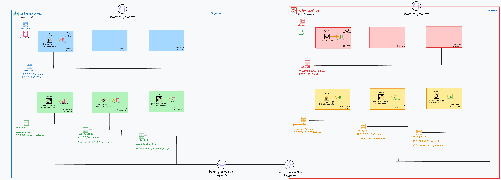

> Hand-drawn in Excalidraw, and the most complete view of the topology — route-table contents,
> AMIs per tier, SG attachments, requester/accepter sides. Two label slips: the right-hand VPC is
> `hc-backend-vpc`, and the region badges say Singapore while everything is built in `us-east-1`.

---

## Stacks

```
fe-network ──┬─> fe-security ──┬─> fe-compute
             └─────────────────┴─> peering <─┬─ be-security <── be-network
                                             └─ be-compute
```
`network → security → {peering, compute}`. Every cross-stack read is `data "terraform_remote_state"`
(backend `remote`) against producer **outputs only**.

| Workspace | ID | Directory | Resources | Owns |
|---|---|---|---|---|
| `hc-frontend-network` | `ws-GPGYRhfZYgWVxRw3` | `frontend-network/` | 19 | VPC, 3+3 subnets, IGW, NAT, route tables |
| `hc-backend-network` | `ws-ZKzAjhVKZRuRzcdb` | `backend-network/` | 19 | mirror |
| `hc-frontend-security` | `ws-2VNi1aAgBARt5SNB` | `frontend-security/` | 17 | SG chain, own VPC only |
| `hc-backend-security` | `ws-nH3SfVrNhVL6AdFj` | `backend-security/` | 17 | mirror |
| `hc-peering` | `ws-R9rpo6kxcLDRqjXR` | `peering/` | 26 | PCX + peer routes + **all cross-VPC SG portals** |
| `hc-frontend-compute` | `ws-dNKgqQpzrXDgniFk` | `frontend-compute/` | 9 | 1 bastion + 3 private instances |
| `hc-backend-compute` | `ws-KUWQdCW8Tg88CXVw` | `backend-compute/` | 9 | mirror |


Two rules shape this split:

- **No workspace reads its mirror twin.** Cross-VPC SG rules live in `peering/`, so both security
  stacks can apply from empty with no ordering between them.
- **Peering owns the whole connection matrix** — PCX, routes, and portals — because a peer-group
  SG reference is only meaningful while the connection exists.

## Pipeline — VCS-driven

No `terraform apply` is run by hand against any stack; VCS-connected workspaces refuse CLI applies.

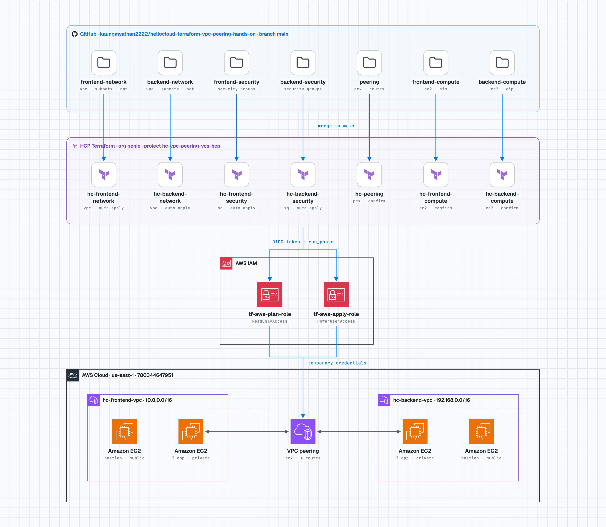

```
branch → commit in one stack folder → PR → speculative plan on that workspace
  → merge to main → real run → apply
```

Workspaces are created by hand in the HCP UI (no `bootstrap/`, no `tfe` provider). Each sets:

| Setting | Value |
|---|---|
| Working directory | the stack's folder, e.g. `frontend-network` |
| Branch | `main`, all seven |
| Trigger patterns | `/<dir>/*` and `/<dir>/**/*` |
| Auto-apply | on, all seven |

**No run triggers.** A workspace runs only when its own files change. Ordering is a human step —
merge in tier order `1 networks → 2 security → 3 peering, compute`; destroy walks it backwards.

Merging PR #11 — the webhook fires, `hc-backend-compute` plans, and the status check reports
no changes because the commit only touched a comment:

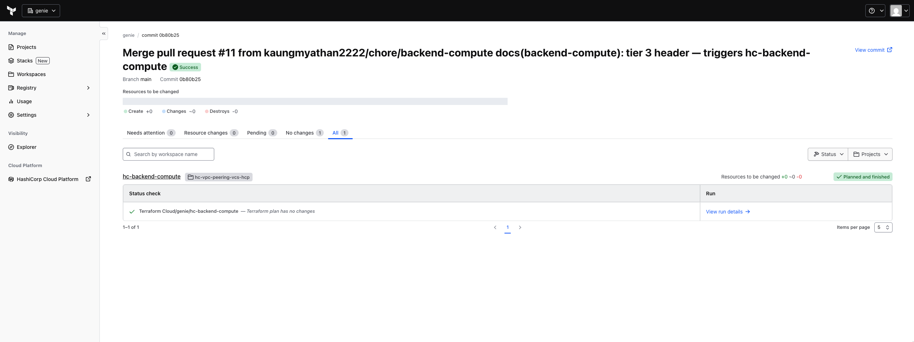

All seven after a full build driven entirely through this pipeline — **0 errored**:

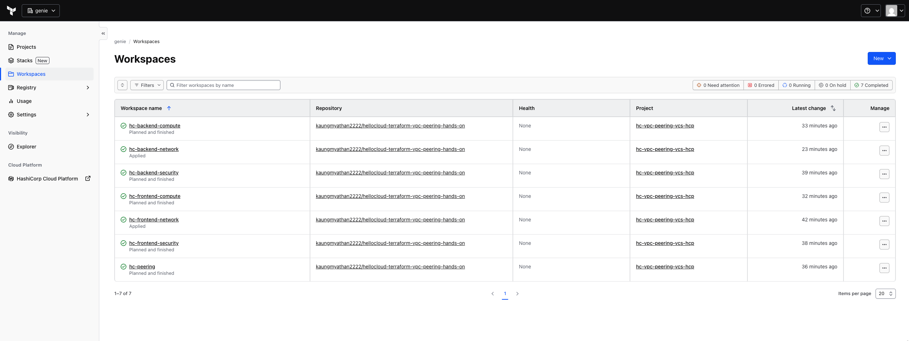

## AWS auth — OIDC

Zero workspace-level variables. Credentials come from a project-scoped variable set, so any
workspace created in `hc-vpc-peering-vcs-hcp` inherits them.

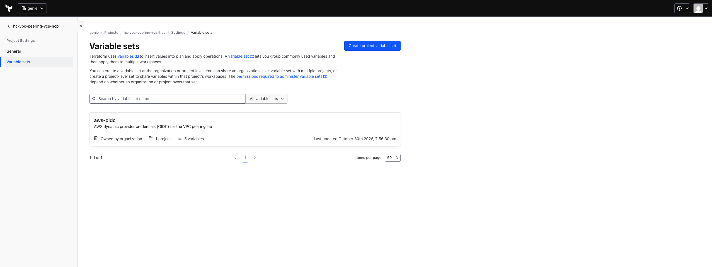

| Key | Category | Value |
|---|---|---|
| `TFC_AWS_PROVIDER_AUTH` | env | `true` |
| `TFC_AWS_WORKLOAD_IDENTITY_AUDIENCE` | env | `aws.workload.identity` |
| `TFC_AWS_PLAN_ROLE_ARN` | env | `…:role/tf-aws-plan-role` |
| `TFC_AWS_APPLY_ROLE_ARN` | env | `…:role/tf-aws-apply-role` |
| `my_ip` | terraform | operator CIDR for the bastion SG |

| Role | Policy | Trust (`StringLike` on `app.terraform.io:sub`) |
|---|---|---|
| `tf-aws-plan-role` | `ReadOnlyAccess` | `organization:genie:project:hc-vpc-peering-vcs-hcp:workspace:*:run_phase:plan` |
| `tf-aws-apply-role` | `PowerUserAccess` | `…:workspace:*:run_phase:apply` |

`StringLike` is what makes `workspace:*` match — one role pair covers all seven. `aud` is pinned
with `StringEquals`. **The project name in `sub` is load-bearing**: a workspace in any other project
gets no variables and matches no trust policy.

`my_ip` has no default in code — a VCS-driven run cannot take `-var`, so a committed default would
become permanent.

## Network

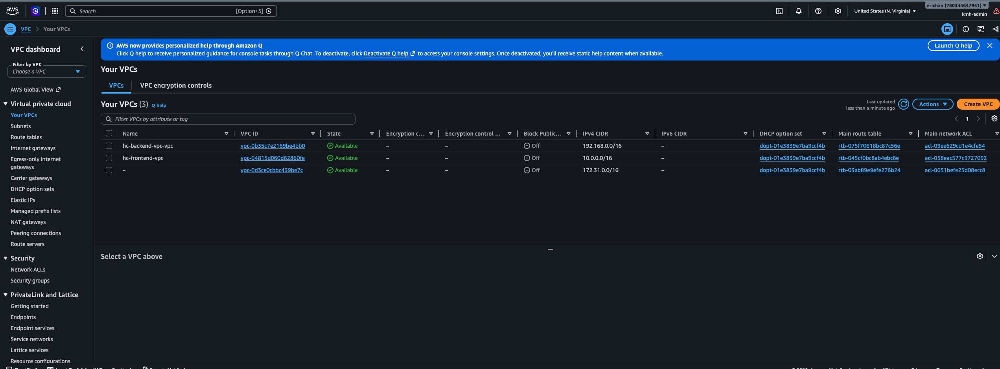

| VPC | ID | CIDR |
|---|---|---|
| `hc-frontend-vpc` | `vpc-04815d060d62860fe` | `10.0.0.0/16` |
| `hc-backend-vpc` | `vpc-0b35c7e2169be4bb0` | `192.168.0.0/16` |

Six subnets per VPC, same-ordinal CIDRs mirrored across sides (`10.0.25x.0/24` ↔ `192.168.25x.0/24`):

- public `-01/-02/-03` → IGW route
- private `-01` → NAT route
- private `-02/-03` → **peer-only tables, no default route**

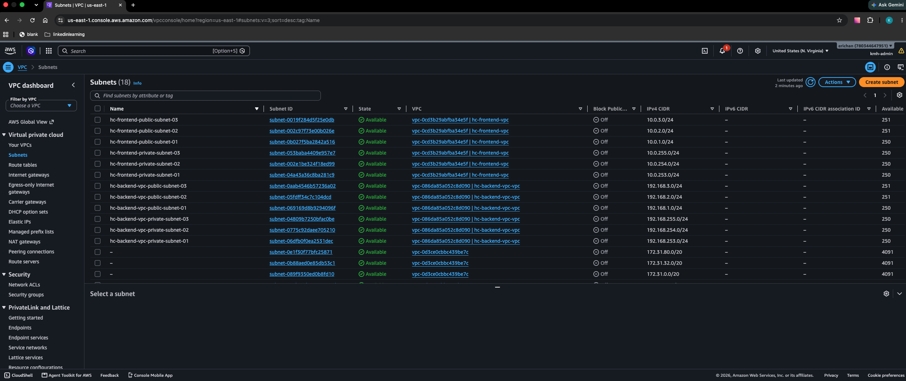
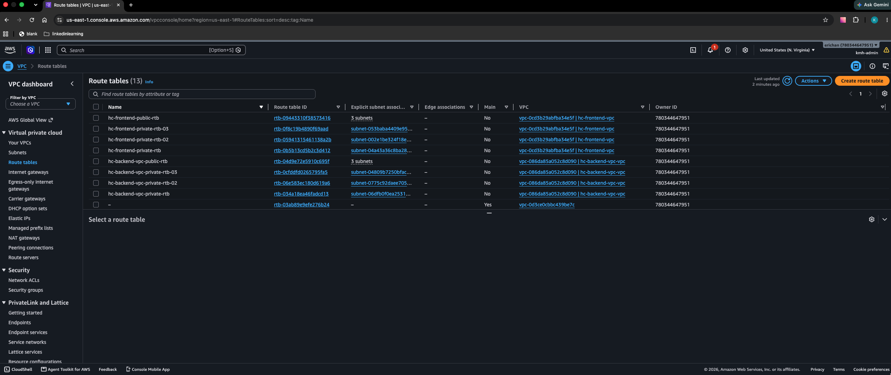

## Peering

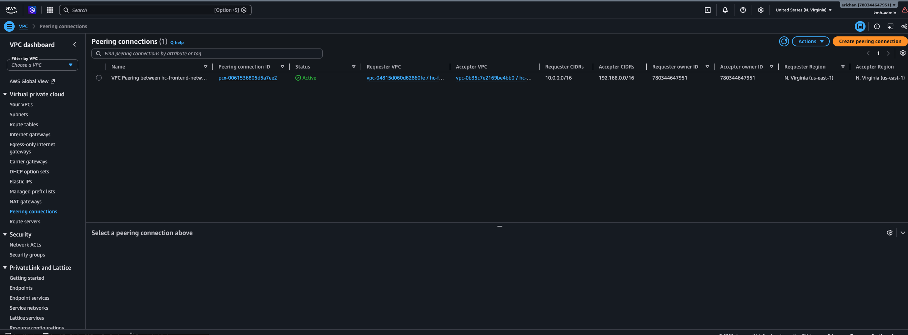

One PCX `pcx-0061536805d5a7ee2`, `auto_accept = true`, carrying exactly four routes — same-ordinal
`/24` to `/24`, never a blanket `/16`:

| Route table | Destination |
|---|---|
| `hc-frontend-private-rtb-02` | `192.168.254.0/24` |
| `hc-frontend-private-rtb-03` | `192.168.255.0/24` |
| `hc-backend-private-rtb-02` | `10.0.254.0/24` |
| `hc-backend-private-rtb-03` | `10.0.255.0/24` |

Public and `-01` tables carry **no** peer route — the negative control below proves it.

DNS across the peer is declared on the connection itself, valid only because both VPCs are in the
same account and region:

```hcl
accepter  { allow_remote_vpc_dns_resolution = true }
requester { allow_remote_vpc_dns_resolution = true }
```

## Security

Standalone rules only — `aws_vpc_security_group_{ingress,egress}_rule`, never inline blocks.

| SG | Inbound | Outbound |
|---|---|---|
| `pub-sgp-01` | SSH + ICMP from operator `/32` | allow-all |
| `pri-sgp-01` | SSH + ICMP from `pub-sgp-01` | allow-all |
| `pri-sgp-02` | `pri-sgp-01` + **peer `pri-sgp-02`** | peer `pri-sgp-02` + UDP 53 to VPC resolver |
| `pri-sgp-03` | `pri-sgp-01` + **peer `pri-sgp-03`** | peer `pri-sgp-03` + UDP 53 to VPC resolver |

The peer halves of `-02`/`-03` live in `peering/`, keyed by a `portals` map with `depends_on` on
the PCX. The `-02`/`-03` tiers have **no allow-all egress** — without the UDP 53 rule they cannot
resolve anything, so peer hostname lookups fail before reachability is tested.

## Evidence

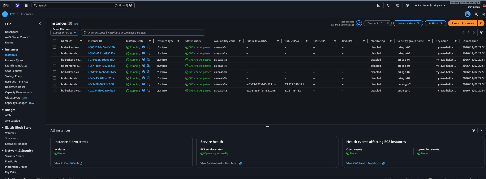

| Role | Instance | ID | IP |
|---|---|---|---|
| FE bastion | `hc-frontend-compute-public-instance` | `i-0c3e0fb38f2142c57` | `13.222.140.121` |
| FE private-01 | `…-private-instance-01` | `i-0f95f8311d698533a` | `10.0.253.156` |
| FE private-02 | `…-private-instance-02` | `i-0a0e15f70fbed71be` | `10.0.254.198` |
| BE private-02 | `…-private-instance-02` | `i-0fd39114bbdd06675` | `192.168.254.60` |
| BE bastion | `hc-backend-compute-public-instance` | `i-020341fc008c94be3` | `3.231.19.182` |

SSH is **three hops, not two** — `pri-sgp-02` trusts `pri-sgp-01`, not `pub-sgp-01`:

```bash
ssh-add my-aws-hellocloud-keypair.pem     # -i is NOT inherited by -J jump hosts
ssh -J ec2-user@13.222.140.121,ubuntu@10.0.253.156 ubuntu@10.0.254.198 \
  'ip route get 192.168.254.60; \
   ping -c 4 192.168.254.60; \
   ping -c 2 -W 2 192.168.253.220 || echo "EXPECTED FAIL: unrouted peer subnet"'
```

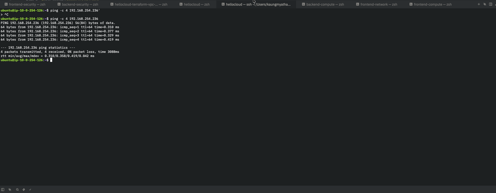

| Signal | Observed | Proves |
|---|---|---|
| `ip route get` | `via …dev ens5` | peer route installed *and selected* |
| `0% packet loss` | rtt 0.31–1.46 ms | PCX active, route out, route back, both SG portals open |
| `ttl=64` | no decrement | peering is a fabric link, not a routed hop |
| peer `-01` subnet → 100% loss | no route in `private-rtb-02` | routes are per-`/24`; packet died at the VPC router |

> Screenshot 12 predates the current rebuild — addresses differ, topology is identical.

## Learnings

**HCP**

- **`queue_all_runs` defaults to `false`; a new workspace swallows its first push.** It ingests the
  config version and queues nothing until one run is started by hand. `configuration-versions` fills
  with `status: uploaded` while `runs` stays `count: 0` — indistinguishable from a broken webhook.
  One manual run clears it permanently.
- **Trigger patterns are globs matched against changed file paths, and need wildcards.**
  `frontend-network/` has none, so it matches that literal path and never `frontend-network/main.tf`
  — PR #5 merged, the webhook fired, a non-speculative config version was created at the right
  commit, and no run queued. `/frontend-network/*` works. Empty patterns work too: HCP then
  triggers on the working directory.
- **Working directory is the code directory**, not a scratch path — it is where `init/plan/apply`
  run. Point it at a folder that does not exist and the run dies before reaching AWS.
- **The `cloud {}` block auto-creates workspaces on `init` — in the org default project.** They
  arrive CLI-driven, with no VCS connection, in the wrong project for the OIDC trust policy. Pin
  `project` in every `cloud {}` block.
- **Run triggers are not a dependency scheduler.** One hop on apply, no waiting for the graph.
  Transitive edges make consumers run too early and error on `terraform_remote_state`; join nodes
  race regardless. Ten of them produced errored runs on four separate occasions. Removed — merging
  in tier order does the same job with no moving parts.
- **Deleting a workspace deletes its state, not its infrastructure.** Two deletions left 38 live
  AWS resources untracked with NAT gateways still billing. No undo.
- **`data "tfe_outputs"` silently returned empty values**; `terraform_remote_state` resolved the
  same outputs instantly. Sharing grants a read — only a trigger causes a re-plan.
- Free tier is one concurrent run. Fan-out serialises; it looks stuck and is not.

**AWS**

- **An active PCX proves almost nothing** — a tunnel with no lanes and locked doors. Routes (both
  directions) and SGs (both directions) are independent control planes that must each be true.
- **ICMP rules are type/code, not ports**: `from_port = 8`, `to_port = -1`. SGs are stateful, so the
  echo reply needs no rule.
- **SG references, not CIDRs**, for cross-VPC portals — route tables already constrain traffic to
  the same-ordinal subnet.
- PCX delete is async; an immediate re-create collides with AWS' idempotency check. Deleted PCX
  objects linger ~2 weeks.
- **`ssh -i` does not reach `-J` jump hosts**, and `%h`/`%p` in a nested `ProxyCommand` expand once
  at the outer hop.

## Teardown

VCS-connected workspaces refuse CLI applies. Destroy from HCP — **Settings → Destruction and
deletion → Queue destroy plan** — in reverse tier order, each strictly after its consumers:

```
fe/be compute → peering → fe/be security → fe/be network
```

Delete the workspaces themselves **last, only after every stack reports zero resources**.
