# Intra-Region VPC Peering — HCP Terraform Remote Execution Hands-On

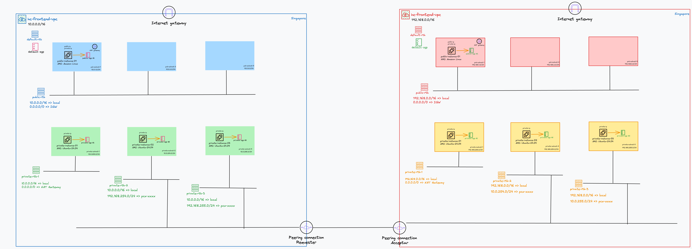

Two mirrored AWS VPCs (`hc-frontend-vpc` `10.0.0.0/16`, `hc-backend-vpc` `192.168.0.0/16`, both `us-east-1`)
built, peered, and firewalled entirely by Terraform — with every plan/apply executed **remotely** in
HCP Terraform (No-Code-style `cloud {}` workspaces, org `genie`), and cross-stack wiring done via
remote state reads.

> Region `us-east-1` · Terraform `>= 1.12` · `hashicorp/aws ~> 6.0` (regional NAT) · 7 HCP workspaces

> Diagram caveats: the right-hand VPC is `hc-backend-vpc` (label typo), and the region badge is
> illustrative — everything is built in `us-east-1`.

---

## Architecture

### Workspace graph (deployment order, strictly linear)

```
hc-frontend-network ──┐
hc-backend-network ───┤
                      ▼
                hc-peering              reads both network stacks
                      ▼
hc-frontend-security      hc-backend-security
        each security stack reads: own network stack + the peer security stack
                      ▼
hc-frontend-compute       hc-backend-compute
        each compute stack reads: own network stack + own security stack
```

| Workspace | Directory | Owns |
|---|---|---|
| `hc-frontend-network` / `hc-backend-network` | `frontend-network/`, `backend-network/` | VPC + 3 public + 3 private subnets, IGW, regional NAT, per-AZ private route tables |
| `hc-peering` | `peering/` | PCX (+ peer DNS resolution) + same-ordinal peer routes |
| `hc-frontend-security` / `hc-backend-security` | `frontend-security/`, `backend-security/` | SG chain (pub-bastion → pri-01 → pri-02/03) + cross-VPC portals |
| `hc-frontend-compute` / `hc-backend-compute` | `frontend-compute/`, `backend-compute/` | Instances (1 public AL2023 bastion + 3 private Ubuntu) |

Design rules that shaped everything below

- one concern per workspace — networks make subnets/routes; peering owns the *connection matrix*;
  security owns allow-lists; compute consumes ids
- **dependency graph is one-directional**: network → peering → security → compute; every cross-stack
  read goes through producer *outputs only* (`data "terraform_remote_state"` / `data "tfe_outputs"`)
- mirrored stacks are structural twins — same HCL, inverted names/CIDRs

### Network layout (per VPC)

Three VPCs exist in the account; the third (`172.31.0.0/16`) is the untouched AWS default.

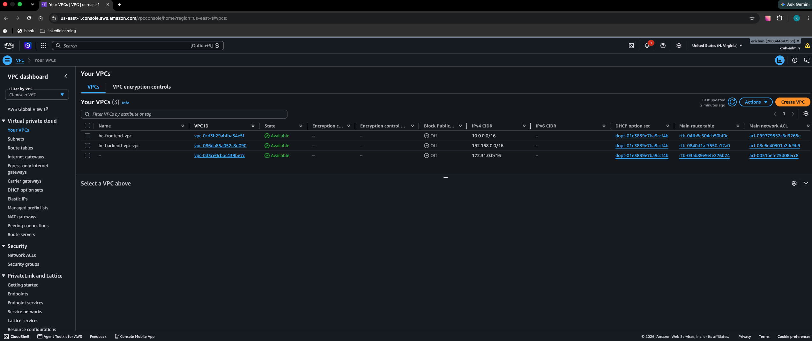

Six subnets per VPC, same-ordinal CIDRs mirrored across sides (`10.0.25x.0/24` ↔ `192.168.25x.0/24`):

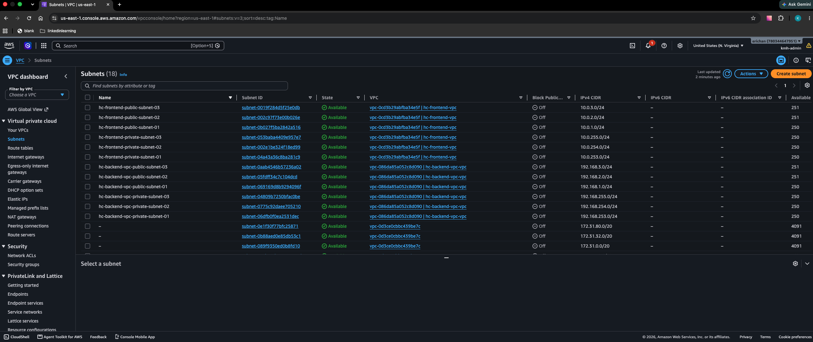

- public subnets `-01/-02/-03` → IGW route (public-rtb)
- private `-01` → regional NAT route
- private `-02/-03` → **peer-only tables** (no default route): the only way out is through the peering

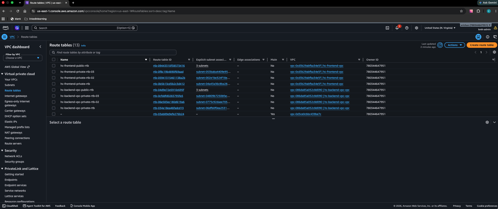

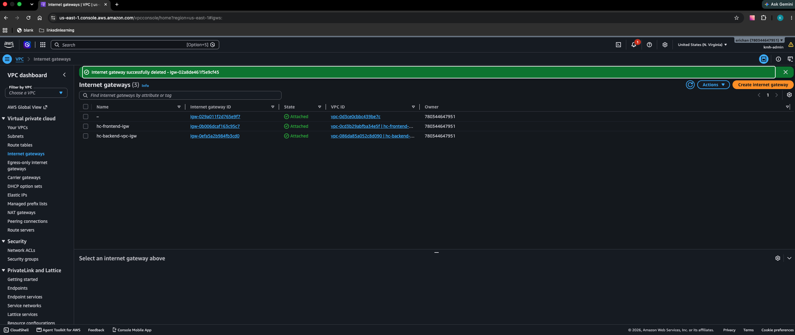

### Peering

One PCX, `auto_accept = true` (same account, same region), carrying exactly four routes —
same-ordinal `/24` to `/24`, never a blanket `/16`:

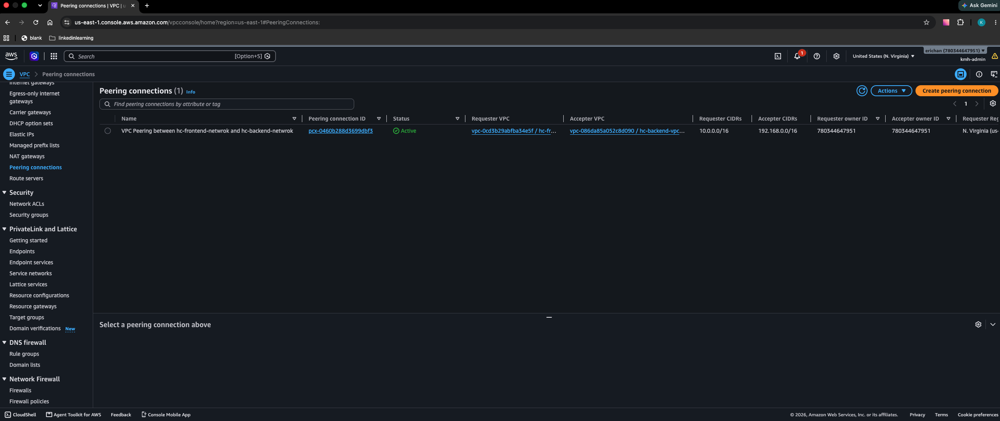

| Route table | Destination | Target |
|---|---|---|
| `hc-frontend-private-rtb-02` | `192.168.254.0/24` | `pcx-…` |
| `hc-frontend-private-rtb-03` | `192.168.255.0/24` | `pcx-…` |
| `hc-backend-vpc-private-rtb-02` | `10.0.254.0/24` | `pcx-…` |
| `hc-backend-vpc-private-rtb-03` | `10.0.255.0/24` | `pcx-…` |

Public tables and the `-01` (NAT) tables carry **no** peer route — deliberate, and the negative
control in the evidence run proves it.

DNS resolution across the peer is declared on the connection itself — nested `accepter {}` /
`requester {}` blocks with `allow_remote_vpc_dns_resolution = true`, so no separate
`aws_vpc_peering_connection_options` resource is needed:

```hcl
resource "aws_vpc_peering_connection" "frontend_to_backend" {
  # ...
  accepter  { allow_remote_vpc_dns_resolution = true }
  requester { allow_remote_vpc_dns_resolution = true }
}
```

Valid here only because both VPCs are in the same account and region; cross-account peering needs
the separate options resource, applied by each side's owner. The evidence capture below predates
this flag, so it is IP-level only.

## Security model

Standalone rules only (best-practice warning honored on the way in):
`aws_vpc_security_group_ingress_rule` / `aws_vpc_security_group_egress_rule`;
never `aws_security_group_rule`, never inline rule blocks.

| SG | Inbound | Outbound |
|---|---|---|
| `pub-sgp-01` | SSH + ICMP from **operator IP /32** | allow-all |
| `pri-sgp-01` | SSH + ICMP from `pub-sgp-01` (SG-ref chain) | allow-all |
| `pri-sgp-02` | from `pri-sgp-01` (own) + **peer `pri-sgp-02`** (SG-ref) | ICMP+SSH **to peer `pri-sgp-02`** + UDP 53 to the VPC resolver |
| `pri-sgp-03` | from `pri-sgp-01` (own) + **peer `pri-sgp-03`** | ICMP+SSH **to peer `pri-sgp-03`** + UDP 53 to the VPC resolver |

Cross-VPC host references resolve through **remote state sharing** (not the
`workspace-outputs` path — see Lessons). SGs are attached inline via
`vpc_security_group_ids` on each instance, so the ENI wears exactly the tier SG.

Note the `-02`/`-03` tiers have **no allow-all egress** — only the two peer portals, plus a single
UDP 53 rule to the VPC resolver (`cidrhost(vpc_cidr, 2)`, a `/32`). Without that rule the boxes
cannot resolve anything at all, so peer *hostname* lookups fail before reachability is ever tested.

## Deploy

```bash
cd terraform/hellocloud-terraform-vpc-peering-hands-on
terraform login            # token from app.terraform.io
# enable Remote Execution + AWS key/value env vars per workspace in HCP UI
terraform init && terraform plan && terraform apply
```

Run order and plan gates (each step is add-only in a clean run):

| Step | Gate |
|---|---|
| 1. FE/BE network | VPC + subnets + IGW + NAT + tables (+0 destroys) |
| 2. peering | 5 adds: 1 PCX + 4 peer routes |
| 3. FE security | 14 adds (4 SGs + their own-VPC rules) |
| 4. BE security | 14 adds |
| 5. cross-VPC portals | 8 adds per side (added only after both sides publish outputs) |
| 6. FE/BE compute | 4 instance creates per side |

> Read every plan bottom-up; in the first deploy the only legitimate diff is the step's adds.
> Anything touching another layer's resources = stop and read.

All seven workspaces applied, each `cloud {}`-backed and CLI-driven:

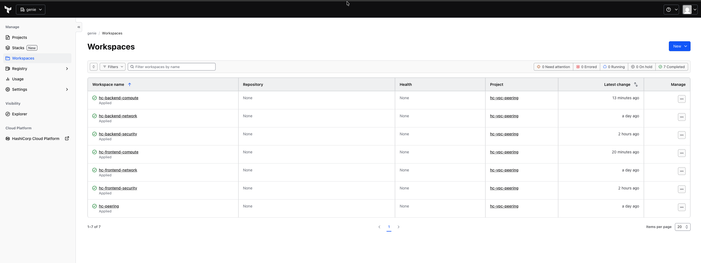

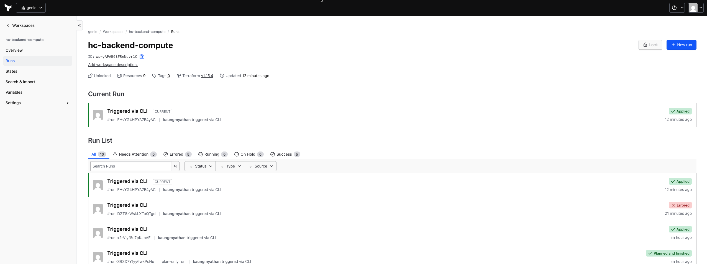

Eight instances running, one bastion + three private per side, each wearing its tier SG:

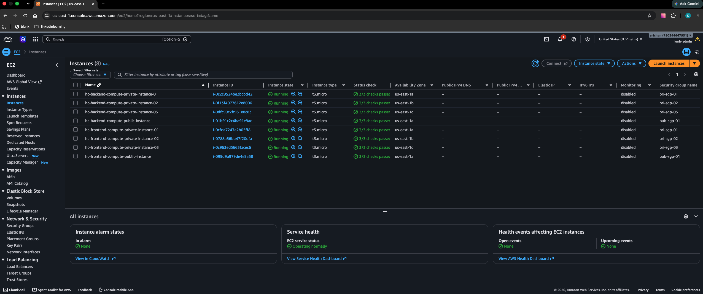

### Evidence run (cross-VPC proof)

The SSH path is **three hops, not two**: `pri-sgp-02` trusts `pri-sgp-01`, *not* `pub-sgp-01`, so the
bastion cannot reach private-02 directly.

```
bastion (pub-sgp-01) → private-01 (pri-sgp-01) → private-02 (pri-sgp-02) → ping peer private-02
```

`ssh -i` is **not** inherited by `-J` jump hosts, so load the key into the agent first:

```bash
ssh-add my-aws-hellocloud-keypair.pem
ssh -J ec2-user@<fe-bastion-public-ip>,ubuntu@10.0.253.74 ubuntu@10.0.254.126 \
  'ip route get 192.168.254.236; \
   ping -c 4 192.168.254.236; \
   ping -c 2 -W 2 192.168.253.198 || echo "EXPECTED FAIL: unrouted peer subnet"'
```

Without an agent, nest the hops explicitly and use literal `host:port` — `%h`/`%p` are expanded once,
by the outer `ssh`, so they would aim every hop at the final host:

```bash
K=my-aws-hellocloud-keypair.pem
ssh -i $K \
  -o ProxyCommand="ssh -i $K -W 10.0.254.126:22 -o ProxyCommand='ssh -i $K -W 10.0.253.74:22 ec2-user@<fe-bastion-public-ip>' ubuntu@10.0.253.74" \
  ubuntu@10.0.254.126
```

Endpoints under test — same ordinal, opposite sides:

| Role | Instance | Private IP | SG |
|---|---|---|---|
| source | `hc-frontend-compute-private-instance-02` | `10.0.254.126` | `pri-sgp-02` (FE) |
| target | `hc-backend-compute-private-instance-02` | `192.168.254.236` | `pri-sgp-02` (BE) |

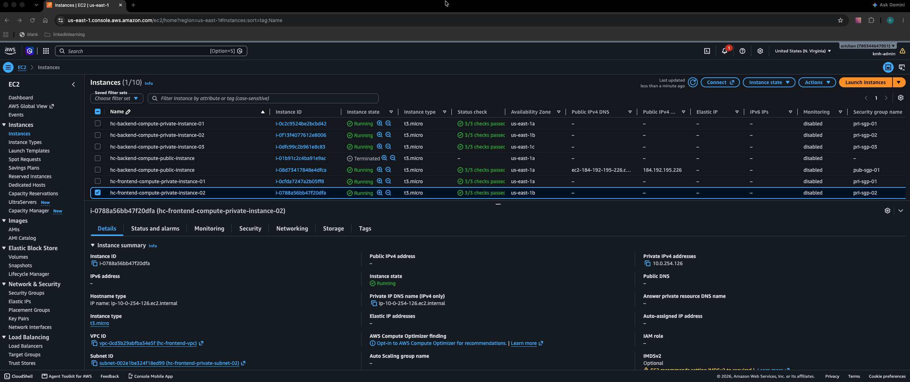

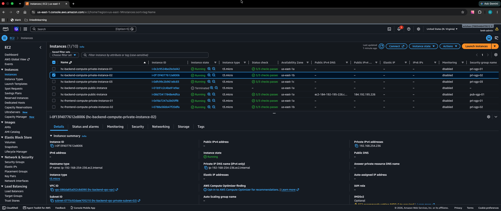

Result — 0% loss, and the control fails exactly as designed:

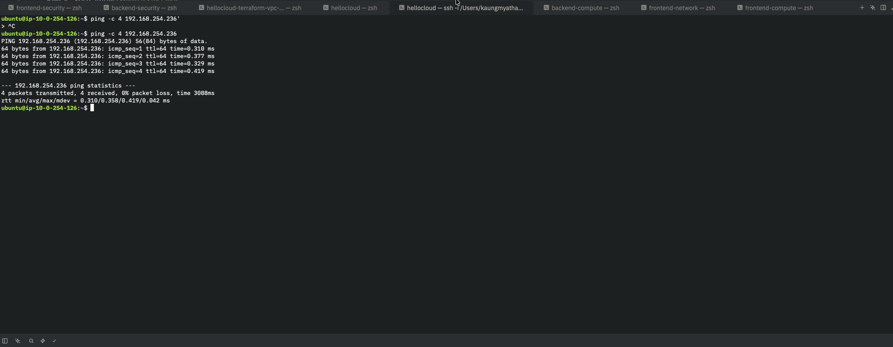

| Signal | Observed | What it proves |
|---|---|---|
| `ip route get` | `via 10.0.254.1 dev ens5` | the peer route is installed *and selected* in `private-rtb-02` |
| `4 received, 0% packet loss` | rtt 0.31–1.46 ms | all four gates true at once: PCX active, route out, route back, both SG portals open |
| `ttl=64` | no decrement | peering is a fabric link, not a routed hop — distinguishes a real PCX path from NAT/transit |
| `192.168.253.198` → 100% loss, silent timeout | no route in `private-rtb-02` | routes are per-`/24`, not a blanket `/16`; packet died at the VPC router, never reached an SG |

Mirror direction (BE → FE, 03 pair) runs the same way through the backend bastion:
`ssh -J ec2-user@<be-bastion-public-ip>,ubuntu@192.168.253.198 ubuntu@192.168.255.92 'ping -c 4 10.0.255.136'`

Hostname variants (`ping ip-192-168-254-236.ec2.internal`) are wired in code — peer DNS resolution
on the PCX plus the UDP 53 resolver egress — but the screenshot above predates both, so re-run the
test after applying `peering/`, `frontend-security/` and `backend-security/` to capture it.

## Learnings

- **Workspace output transports are not interchangeable.** `data "tfe_outputs"` silently returned
  empty values on cross-sec-workspace reads, while `data "terraform_remote_state"` (backend `remote`)
  resolved the same outputs instantly. Remote state sharing is the reliable path.
- Cross-account SG rules: AWS `referenced_security_group_id` over peering is valid within the same
  account/region; but build order matters — publish outputs (v1 apply) before adding cross-references.
- **ICMP rules in SGs are type/code, not ports**: `from_port = 8` (echo request), `to_port = -1`
  (all codes). SGs are stateful, so the echo *reply* needs no rule of its own.
- **SG references, not CIDRs**, for the cross-VPC portals: the route tables already constrain traffic
  to the same-ordinal subnet, so the SG only needs to name the peer group.
- **An active PCX proves almost nothing.** It is a tunnel with no lanes and locked doors: routes
  (both directions) and SGs (both directions) are independent control planes that must each be true.
- `moved {}` blocks: renaming a resource address *can* recreate the same PEER ID vs destroy+create
  (strike against pure renames on stateful resources); PCX delete is async — an immediate re-create
  collides with AWS' idempotency ("matching peering exists with different tags").
- Both compute workspaces' states hold `backend_*` resource addresses; renaming them to match the
  side would have been 4 destroys + 4 creates for cosmetics. Tags (`hc-frontend-*`) carry the
  distinction instead.
- **`ssh -i` does not reach `-J` jump hosts**, and `%h`/`%p` in a nested `ProxyCommand` expand once
  at the outer hop — two quiet traps when a bastion chain is more than one hop deep.

## Teardown

Destroy in **reverse order** of the deploy order; destroy each strictly after its consumers are gone:

```bash
# fe/be compute → fe/be security → peering → fe/be network
terraform destroy -auto-approve
```

Deleted PCX objects linger in the account for ~2 weeks ("deleted" state) and can briefly collide
with a re-create of the pair. States (and their outputs, evidence) live in `app.terraform.io`.
